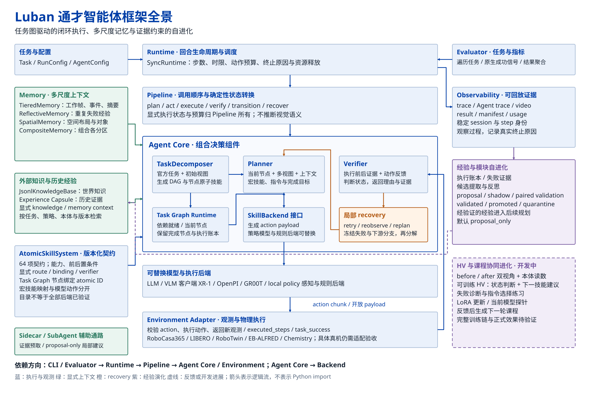

<div align="center">
  <picture>
    <source media="(prefers-color-scheme: dark)" srcset="docs/assets/luban-wordmark-dark.svg">
    
  </picture>
  <p><a href="README.md">English</a> · <a href="README.zh-CN.md">简体中文</a></p>
  <p><strong>Composable embodied agents, with observable closed-loop execution.<br>可组合的具身智能体框架，提供可观测的闭环执行。</strong></p>
  <p><picture>
    <source media="(prefers-color-scheme: dark)" srcset="docs/assets/luban-pillars-dark.svg">
    
  </picture></p>
  <!-- project-links:start -->
  <p><a href="https://6acd9e44e89af57fccde9564--friendly-hotteok-b5a87f.netlify.app/">Project</a> · <a href="docs/project-page.md#arxiv">arXiv (Coming soon)</a> · <a href="https://6acd9e44e89af57fccde9564--friendly-hotteok-b5a87f.netlify.app/demos.html">Demo</a> · <a href="docs/README.md">Docs</a> · <a href="https://6acda06095d8304cc3c58976--luban-consoles-20261008.netlify.app/offline/">Offline Replay</a></p>
  <!-- project-links:end -->
</div>

## Abstract

Luban is an embodied-agent framework that combines self-evolution, memory and spatial reconstruction. Typed atomic skills serve as its units of capability: task-graph planning decomposes language goals, an independent verifier tracks each subtask, and stalls or failures trigger retries, node recovery or replanning. Tiered memory retains recent observations and key events; reflective memory summarizes task experience; spatial memory organizes scene entities and relations; knowledge capsules store retrievable procedural knowledge; and self-evolution turns execution records into evaluated, reusable experience for later planning. Current progress: on LIBERO (four suites, 40 tasks, 2,000 episodes), the reported results are 96.7% for Without Agent and 98.9% for Agent (see [metric definitions](docs/reported-results.md)); on RoboCasa365, self-evolution lifts composite seen success from 65.0% to 68.6% and atomic seen success from 82.1% to 85.5%; validation also covers RoboTwin 2.0 bimanual collaboration, an Isaac Sim chemistry demo, Franka FR3 / MR1000 real-robot manipulation, and Go2 / LIMO navigation.

[](docs/assets/luban-framework.svg)

<p align="center"><sub>Latest supplied architecture diagram (2026-10-18). Open the original SVG for detail.</sub></p>

## Spatial memory and application materials

The spatial module turns RGB-D, camera poses and existing point clouds into queryable scene entities. The supplied single-scene record contains 16 entities, with 3.368 s SpatialLM inference. An interface replay experiment reports 0.1496 ms mean recall latency and unchanged global-scene output after 1,000 resets. See [spatial report provenance and settings](docs/spatial-memory-report.md).

The 2026-10-18 local website adds traffic robot, tunnel quadruped and highway drone materials as partner application scenarios. Physical-robot integration support remains defined by this repository's hardware and environment guides. The updated website and offline console share one local delivery folder, awaiting publication with a new account. Project and Offline Replay links at the top still point to the 2026-10-13 previews.

## Roadmap

- [ ] Open-source the Franka FR3 / MR1000 and Go2 / LIMO real-robot workspaces
- [ ] Share a curated set of knowledge capsules and evolved experience records
- [ ] Generalize bimanual and multi-agent collaboration tasks

## Leaderboard · Reported results

Results reproduced from the project presentation. See [protocol and provenance](docs/reported-results.md).

**RoboCasa365 · XR-1** — task success rate

| Setting | Composite seen | Atomic seen |
| --- | ---: | ---: |
| XR-1 baseline | 57.1% | 80.2% |
| Luban without self-evolution | 65.0% | 82.1% |
| **Luban with self-evolution** | **68.6%** | **85.5%** |

**LIBERO · OpenVLA-OFT** — 40 tasks, 2,000 episodes

| Suite | Without Agent | Agent |
| --- | ---: | ---: |
| LIBERO Goal | 98.4% | 99.4% |
| LIBERO Spatial | 97.6% | 99.4% |
| LIBERO Object | 97.4% | 99.2% |
| LIBERO Long (libero_10) | 93.4% | 97.6% |
| **Overall** | **96.7%** | **98.9%** |

The LIBERO figures are computed over the original episode IDs with different
execution budgets; see [metric definitions](docs/reported-results.md).

**RoboTwin 2.0 and RoboSynChallenge**

RoboTwin 2.0 reports 3,079 successful episodes out of 5,000 (61.58%). RoboSynChallenge reports 412 out of 1,000 (41.2%). They use separate bimanual and laboratory-manipulation settings. See [protocols and sources](docs/reported-results.md).

These are historical project report results;
this package's execution example is documented in the [episode guide](docs/episodes.md).

## Hardware

| Device / embodiment | Support in this repository |
| --- | --- |
| **CPU host** | Installation, offline mock example, configuration and client logic; tested on Ubuntu 22.04 / Python 3.11. |
| **NVIDIA CUDA GPU** | XR-1 inference and RoboCasa EGL rendering; exercised on one RTX 4090 48 GB. Eight GPUs are not required; minimum VRAM has not been established. |
| **PandaOmron (simulation)** | RoboCasa365 observations and 12-dimensional mobile-manipulator actions, with a real-policy episode configuration. |
| **Other simulated embodiments** | LIBERO, RoboTwin, EB-ALFRED and Chemistry adapters; embodiment, SDK and resources depend on the selected environment. |
| **Physical robots** | An extensible `Environment` interface and injected ROS2 transport contracts; no specific physical robot deployment has been accepted in this repository. |

The Franka FR3 / MR1000 and Go2 / LIMO platforms mentioned in the project abstract
belong to separate robot/navigation workspaces in the broader project. Those
workspaces are not distributed here. See [environment/robot interfaces](docs/environments.md)
and [hardware/resource installation](docs/installation.md).

## Offline replay console

[Open the offline replay console](https://6acda06095d8304cc3c58976--luban-consoles-20261008.netlify.app/offline/) to inspect eight recorded episodes with three camera views, task graphs and events. The current online version is the 2026-10-13 preview and requires no model API configuration or backend connection. For real execution, use the [episode guide](docs/episodes.md). See [console entry details](docs/reader-console.md).

## Capabilities

| Capability | How it works |
| --- | --- |
| **Closed-loop execution** | Compose planners, policies, environments, verifiers and memory; choose direct execution or a task-graph pipeline |
| **GPU simulation and policy** | Connect RoboCasa365 to an independent XR-1 inference service; start with the bounded `CloseBlenderLid` example |
| **Model and policy clients** | OpenAI-compatible planning; XR-1/RLDX over ZeroMQ, OpenPI over WebSocket, Chemistry over gRPC |
| **Task graphs and memory** | Task decomposition, atomic-skill routing, experience records and evolution gates |
| **Observable runs** | Results, explicit termination reasons, step traces, optional video and a local Dashboard |
| **Low-cost quickstart** | A CPU mock counter checks installation and configuration without a model, GPU or API |

Additional environment adapters include LIBERO, RoboTwin, EB-ALFRED and Chemistry.
Prepare external SDKs, models and assets for the environment you select. See
[environment integration](docs/environments.md) for interfaces and execution scope.

Synchronous runtimes enforce steps, chunks, retries and timeouts with explicit
termination reasons. Pipelines own control flow; policies produce action payloads;
environments execute them; verifiers interpret feedback. Memory records facts and
events. [Architecture](impl_docs/architecture/overview.md) describes module boundaries.
Adapter presence and historical catalog evidence do not establish live task quality.

## Install and run on CPU

Prerequisites: Python **3.11**, [uv](https://docs.astral.sh/uv/getting-started/installation/)
and repository access. The tested host is Ubuntu 22.04.5.

```bash
git clone --branch codex/private-readiness --single-branch https://github.com/Luban-Agents/Luban.git
cd Luban
uv sync --frozen --no-dev --python 3.11
uv run --frozen --no-dev python -m luban.examples.offline
uv run --frozen --no-dev luban run --config configs/runs/offline.yaml
```

Expect two `increment` actions, `success: true` and
`termination_reason: task_success`. Results appear under
`runs/offline_demo/<session_id>/` and `runs/offline_config/<session_id>/`.
This checks installation and software flow using a mock counter.

For Conda or pip installation, distribution packages and external resources,
follow [installation](docs/installation.md). The checked-in lock is maintained
from project requirements, not exported from a shared server environment.

## Verify on a new machine

The full CPU check includes optional clients, Dashboard, HDF5 replay and CPU tensor
storage. It needs FFmpeg/ffprobe for video checks, but no GPU or API credentials.
Torch is confined to the optional `full-test` group and uses CPU wheels on Linux/Windows.

```bash
uv sync --frozen --all-extras --group dev --group docs --group full-test --python 3.11
REQUIRE_NO_SKIPS=1 bash scripts/ci.sh
.venv/bin/mkdocs build --strict
.venv/bin/python scripts/check_distribution.py
```

[New-machine instructions](docs/new-machine.md) cover repository authentication,
prerequisites, expected outputs and the difference between software checks and a
real simulation. The [CI workflow](.github/workflows/ci.yml) uses a fresh Ubuntu
runner, read-only repository permissions and no private service credentials.

## GPU simulation and policy inference

First prepare the simulator, licensed assets and independent policy service in
[installation](docs/installation.md), then use the complete
[episode guide](docs/episodes.md). With `SIM_PYTHON` and
`LUBAN_ROBOCASA_ROOT` set to your installation:

```bash
export MUJOCO_GL=egl PYOPENGL_PLATFORM=egl
export CUDA_VISIBLE_DEVICES=0 MUJOCO_EGL_DEVICE_ID=0
"$SIM_PYTHON" -m luban health --agent-config configs/agents/xr1_simple.yaml
"$SIM_PYTHON" -m luban run --config configs/runs/robocasa_simple.yaml
```

The service listens on `127.0.0.1:18400` in `planner_subtask` / `episode_step`
mode. The example fixes `CloseBlenderLid`, target split, index 0, seed 7,
600 environment steps, 38 chunks and a 600-second runtime budget. A deterministic
planner selects the native instruction; XR-1 produces real actions. This example
does not use an LLM planner.

The fresh simulator-environment run ended with native `task_success`, 352 environment steps,
22 chunks and zero exceptions. It produced a trace, result, artifact manifest and
video. This single episode is an execution check, not a success-rate estimate.
CLI exit 0 alone does not indicate task success; inspect `result.json`.

See the optional [multimodal task-graph episode](docs/advanced-episode.md) for the
existing integrated ScrubCuttingBoard catalog and a bounded model-driven entry.

## Configure and inspect

| Location | Purpose |
| --- | --- |
| [`configs/agents/`](configs/agents) | Agent components, backend and memory |
| [`configs/runs/`](configs/runs) | Environment, task, pipeline, budgets and recorder |
| [`catalogs/`](catalogs) | Atomic-skill contracts, example bundles and historical fixtures |
| `runs/<experiment>/<session_id>/` | New results, traces and optional video; ignored by Git |

YAML uses `class_path` / `init_args` matching actual constructors. `${NAME}` and
`${NAME:-default}` expand during loading. `.env` is not loaded automatically;
export variables explicitly. The HTTP backend reads `OPENAI_API_KEY` from the
environment. [Configuration](docs/configuration.md) lists defaults and path rules;
[models and policies](docs/models.md) explains observations, action schemas and
the optional live-model counter example.

## Documentation

Every detailed guide is available in English and 简体中文; switch languages at the top of a guide.

| Get started | Run and integrate | Maintain and review |
| --- | --- | --- |
| [Quickstart](docs/quickstart.md) | [Episodes](docs/episodes.md) | [Development and tests](docs/development.md) |
| [New machine](docs/new-machine.md) | [Models and policies](docs/models.md) | [Project & demo](docs/project-page.md) |
| [Installation and resources](docs/installation.md) | [Environment/robot adapters](docs/environments.md) | [Source provenance](docs/provenance.md) |
| [Configuration](docs/configuration.md) | [Logs and results](docs/results.md) | [Third-party notices](THIRD_PARTY_NOTICES.md) |
| [Troubleshooting](docs/troubleshooting.md) | [Existing research configs](configs/README.md) | [Project-page references](docs/project-page-references.md) |

For cloning and edit locations, see [Access and editing](docs/access.md).


## Contributing and license

See [CONTRIBUTING.md](CONTRIBUTING.md), [LICENSE](LICENSE), [NOTICE](NOTICE) and
[third-party notices](THIRD_PARTY_NOTICES.md). Original source attribution is retained in [provenance](docs/provenance.md).

## Citation and Acknowledgement

**Citation — Coming soon.** The final paper title, authors, arXiv identifier and
BibTeX will be supplied when ready. Current software provenance is in [CITATION.md](CITATION.md).

**Acknowledgement — Coming soon.** Collaborator, institution and funding details
will be added before release. Existing code and resource attribution remains in
[NOTICE](NOTICE) and [third-party notices](THIRD_PARTY_NOTICES.md).
