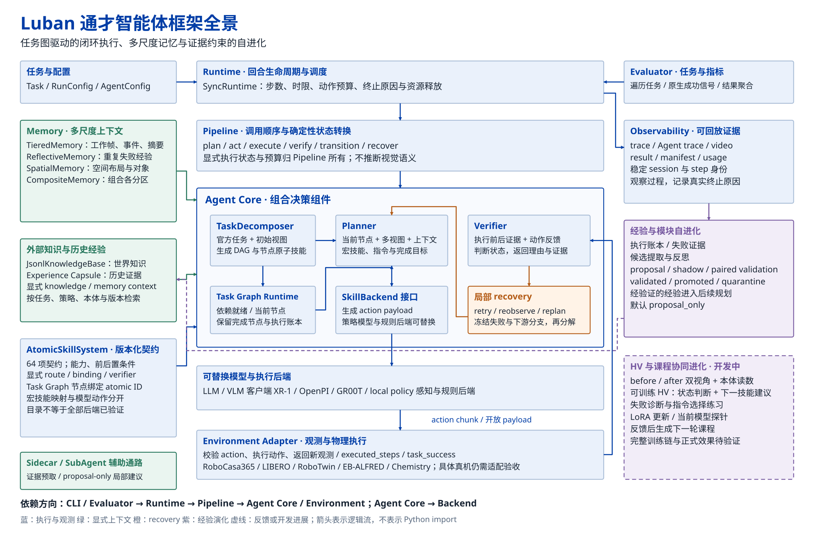

<div align="center">
  <picture>
    <source media="(prefers-color-scheme: dark)" srcset="docs/assets/luban-wordmark-dark.svg">
    
  </picture>
  <p><a href="README.md">English</a> · <a href="README.zh-CN.md">简体中文</a></p>
  <p><strong>可组合的具身智能体框架，提供可观测的闭环执行。<br>Composable embodied agents, with observable closed-loop execution.</strong></p>
  <p><picture>
    <source media="(prefers-color-scheme: dark)" srcset="docs/assets/luban-pillars-dark.svg">
    
  </picture></p>
  <!-- project-links:start -->
  <p><a href="https://6acd9e44e89af57fccde9564--friendly-hotteok-b5a87f.netlify.app/">Project</a> · <a href="docs/project-page.zh-CN.md#arxiv">arXiv (Coming soon)</a> · <a href="https://6acd9e44e89af57fccde9564--friendly-hotteok-b5a87f.netlify.app/demos.html">Demo</a> · <a href="docs/README.zh-CN.md">Docs</a> · <a href="https://6acda06095d8304cc3c58976--luban-consoles-20261008.netlify.app/offline/">Offline Replay</a></p>
  <!-- project-links:end -->
</div>

## 摘要 · Abstract

六通智能体（Luban）是一个融合自进化、记忆与空间重建的具身智能体框架。它以类型化原子技能作为能力单元：任务图规划负责分解语言目标，独立验证器跟踪每个子任务的进展，出现停滞或失败时自动触发重试、节点恢复或重规划。分层记忆保留近期观测与关键事件，反思式记忆归纳任务经验，空间记忆组织场景实体与空间关系，知识胶囊沉淀可检索的过程知识；自进化则把执行记录转化为经过评估、可复用的经验，反哺后续任务规划。目前进展：在 LIBERO 四个套件、40 个任务、共 2,000 个回合上，Without Agent 与 Agent 的报告结果分别为 96.7% 和 98.9%（统计定义见[结果说明](docs/reported-results.zh-CN.md)）；在 RoboCasa365 上，加入自进化将复合已见任务成功率从 65.0% 提升至 68.6%、原子已见任务从 82.1% 提升至 85.5%；此外还完成了 RoboTwin 2.0 双臂协作、Isaac Sim 化学操作演示、Franka FR3 / MR1000 真机操作以及 Go2 / LIMO 导航平台的验证。

[](docs/assets/luban-framework.svg)

<p align="center"><sub>2026-10-18 指定的最新智能体架构图，点击查看原始 SVG。</sub></p>

## 空间记忆与应用材料

空间模块将 RGB-D、相机位姿与已有点云转换为可查询的场景实体。所提供单场景记录包含 16 个实体，SpatialLM 推理耗时 3.368 s。接口回放实验中，平均 recall 耗时为 0.1496 ms，全局场景经历 1,000 次 reset 后保持不变。运行配置与来源见[空间记忆报告说明](docs/spatial-memory-report.zh-CN.md)。

2026-10-18 本地展示页补充了交通管理机器人、隧道机器狗与公路无人机素材。它们用于介绍合作应用场景，独立框架的实体机器人接入范围仍以本仓库硬件与环境文档为准。新版网站与离线控制台已整理为一个本地交付目录，待新账号就绪后发布。顶部 Project 和 Offline Replay 链接仍指向 2026-10-13 的在线预览。

## Roadmap · 未来展望

- [ ] 开源 Franka FR3 / MR1000 与 Go2 / LIMO 真机工作区
- [ ] 共享精选知识胶囊与自进化经验记录
- [ ] 泛化双臂与多智能体协作任务

## Leaderboard · 汇报结果

以下沿用项目展示页中的汇报数据，具体统计口径见[结果说明](docs/reported-results.zh-CN.md)。

**RoboCasa365 · XR-1** — 任务成功率

| 设置 | Composite seen | Atomic seen |
| --- | ---: | ---: |
| XR-1 基线 | 57.1% | 80.2% |
| Luban，无自进化 | 65.0% | 82.1% |
| **Luban，有自进化** | **68.6%** | **85.5%** |

**LIBERO · OpenVLA-OFT** — 40 个任务，2,000 个回合

| 套件 | Without Agent | Agent |
| --- | ---: | ---: |
| LIBERO Goal | 98.4% | 99.4% |
| LIBERO Spatial | 97.6% | 99.4% |
| LIBERO Object | 97.4% | 99.2% |
| LIBERO Long（libero_10） | 93.4% | 97.6% |
| **整体** | **96.7%** | **98.9%** |

LIBERO 指标按原始回合 ID 统计，两列执行预算不同，详见[结果说明](docs/reported-results.zh-CN.md)。

**RoboTwin 2.0 与 RoboSynChallenge**

RoboTwin 2.0 的报告结果为 3,079 / 5,000 回合成功，成功率 61.58%。RoboSynChallenge 的报告结果为 412 / 1,000 回合成功，成功率 41.2%。两组结果分别对应双臂操作与实验室操作设置，来源与配置见[结果说明](docs/reported-results.zh-CN.md)。

这是项目历史汇报数据；本安装包的单回合运行结果见[运行指南](docs/episodes.zh-CN.md)。

## Hardware

| 设备／本体 | 当前仓库提供的支持 |
| --- | --- |
| **CPU 主机** | 安装、离线 mock 示例、配置与客户端逻辑；已在 Ubuntu 22.04 / Python 3.11 验证。 |
| **NVIDIA CUDA GPU** | XR-1 推理与 RoboCasa EGL 渲染；已用单张 RTX 4090 48 GB 运行。无需 8 卡，最低显存要求尚未测定。 |
| **PandaOmron（仿真）** | RoboCasa365 观测与 12 维移动操作动作接口，提供真实策略回合配置。 |
| **其他仿真本体** | LIBERO、RoboTwin、EB-ALFRED、Chemistry 环境适配器；具体本体、SDK 与资源由对应环境配置。 |
| **实体机器人** | `Environment` 扩展接口与 ROS2 注入式通信契约；本仓库没有完成具体实体机器人的部署验收。 |

项目摘要涉及的 Franka FR3／MR1000、Go2／LIMO 来自更大项目的独立机器人与导航工作区，
这些工作区不随本仓库分发。接入职责见[环境与机器人接口](docs/environments.zh-CN.md)，
计算设备和资源准备见[安装指南](docs/installation.zh-CN.md)。

## 离线案例演示台

[打开离线案例演示台](https://6acda06095d8304cc3c58976--luban-consoles-20261008.netlify.app/offline/)，可查看八个录制回合的三路画面、任务图与事件。当前在线版本为 2026-10-13 预览，不需要配置模型 API 或连接后台。真实运行的安装与配置见[运行指南](docs/episodes.zh-CN.md)，演示入口说明见[控制台说明](docs/reader-console.zh-CN.md)。

## 主要能力

| 能力 | 使用方式 |
| --- | --- |
| **闭环任务执行** | 组合规划器、策略、环境、验证器与记忆；配置直接执行或任务图 Pipeline |
| **GPU 仿真与策略** | RoboCasa365 环境连接独立 XR-1 推理服务；提供预算明确的 `CloseBlenderLid` 示例 |
| **模型与策略接入** | OpenAI-compatible 规划后端；XR-1/RLDX ZeroMQ、OpenPI WebSocket、Chemistry gRPC 客户端 |
| **任务图与记忆** | 任务分解、原子技能路由、经验记录及演化门控组件 |
| **运行可观测性** | 结果、明确终止原因、逐步 trace、可选视频与本地 Dashboard |
| **低成本入门** | CPU mock 计数环境，检查安装和配置，不需要模型、GPU 或 API |

环境适配器还包括 LIBERO、RoboTwin、EB-ALFRED 与 Chemistry；外部 SDK、模型与
资产按所选环境准备。适配接口和实际运行范围见[环境指南](docs/environments.zh-CN.md)。

同步 Runtime 管理步数、动作块、重试、超时及明确的终止原因。Pipeline 组织调用顺序；
策略产生动作，环境执行动作，Verifier 解释反馈，Memory 记录事实和事件。
[架构说明](impl_docs/architecture/overview.md)给出各模块职责。适配器存在或历史目录
证据不代表对应环境已完成真实任务验证。

## CPU 安装与首次运行

需要 Python **3.11**、[uv](https://docs.astral.sh/uv/getting-started/installation/)
和仓库访问权限。已验证 Ubuntu 22.04.5。

```bash
git clone --branch codex/private-readiness --single-branch https://github.com/Luban-Agents/Luban.git
cd Luban
uv sync --frozen --no-dev --python 3.11
uv run --frozen --no-dev python -m luban.examples.offline
uv run --frozen --no-dev luban run --config configs/runs/offline.yaml
```

预期执行两次 `increment`，得到 `success: true` 和
`termination_reason: task_success`。产物分别位于
`runs/offline_demo/<session_id>/` 与 `runs/offline_config/<session_id>/`。
这是 mock 计数环境，只验证安装与软件流程，不是模型或机器人评测。

其他安装方式、分发包和外部资源见[安装说明](docs/installation.zh-CN.md)。锁文件根据
项目实际要求维护，没有将共享服务器的整个 Python 环境导出为依赖。

## 在新机器上完整验证

完整 CPU 检查包含可选客户端、Dashboard、HDF5 和 CPU tensor 存储。视频测试需要
FFmpeg/ffprobe，但不需要 GPU 或 API 凭据。Torch 仅在可选 `full-test` 组中，
Linux/Windows 使用 CPU wheel。

```bash
uv sync --frozen --all-extras --group dev --group docs --group full-test --python 3.11
REQUIRE_NO_SKIPS=1 bash scripts/ci.sh
.venv/bin/mkdocs build --strict
.venv/bin/python scripts/check_distribution.py
```

[新机器指南](docs/new-machine.zh-CN.md)包含仓库认证、系统工具、预期输出，以及软件
检查与真实仿真的区别。[CI workflow](.github/workflows/ci.yml)在全新 Ubuntu runner
上执行，只具有仓库读取权限，不使用模型密钥或私有服务。

## GPU 仿真与策略运行

先按[安装说明](docs/installation.zh-CN.md)准备模拟器、授权资产和独立策略服务，再按
[回合指南](docs/episodes.zh-CN.md)运行。将 `SIM_PYTHON` 和
`LUBAN_ROBOCASA_ROOT` 设置为你实际安装的位置：

```bash
export MUJOCO_GL=egl PYOPENGL_PLATFORM=egl
export CUDA_VISIBLE_DEVICES=0 MUJOCO_EGL_DEVICE_ID=0
"$SIM_PYTHON" -m luban health --agent-config configs/agents/xr1_simple.yaml
"$SIM_PYTHON" -m luban run --config configs/runs/robocasa_simple.yaml
```

策略服务使用 `127.0.0.1:18400`，配置为 `planner_subtask` / `episode_step` 模式。
示例固定 `CloseBlenderLid`、target split、index 0、seed 7，最多 600 个环境步、
38 个动作块、600 秒 Runtime 预算。确定性规划器选择原生任务指令，XR-1 产生真实
动作；这个示例不调用 LLM 规划器。

独立仿真环境的新回合得到原生 `task_success`，352 个环境步、22 个动作块、0 个异常，并生成
trace、结果、产物清单和视频。这一次成功只证明该回合运行结果，不构成总体成功率。
CLI exit 0 不等于任务成功，还要检查 `result.json`。

已有组合任务目录中的 `ScrubCuttingBoard` 提供了可选的
[多模态任务图示例](docs/advanced-episode.zh-CN.md)，模型调用与实际失败结果单独记录。

## 配置与输出

| 位置 | 用途 |
| --- | --- |
| [`configs/agents/`](configs/agents) | 智能体组件、后端与记忆 |
| [`configs/runs/`](configs/runs) | 环境、任务、Pipeline、预算与记录器 |
| [`catalogs/`](catalogs) | 原子技能合同、示例与历史小型夹具 |
| `runs/<experiment>/<session_id>/` | 新结果、trace 和可选视频；Git 忽略此目录 |

YAML 的 `class_path` / `init_args` 对应真实构造函数。加载时支持 `${NAME}` 和
`${NAME:-default}` 展开。`.env` 不自动加载，需要显式 export；HTTP 后端从环境
读取 `OPENAI_API_KEY`。[配置说明](docs/configuration.zh-CN.md)列出默认值和路径规则；
[模型与策略](docs/models.zh-CN.md)说明观测、动作要求与可选真实模型计数示例。

## 文档导航

首页与详细使用指南均提供中英两版，可在每篇文档顶部切换语言。

| 开始使用 | 运行与接入 | 开发与审阅 |
| --- | --- | --- |
| [快速开始](docs/quickstart.zh-CN.md) | [运行回合](docs/episodes.zh-CN.md) | [开发与测试](docs/development.zh-CN.md) |
| [新机器验证](docs/new-machine.zh-CN.md) | [模型与策略](docs/models.zh-CN.md) | [Project 与 Demo](docs/project-page.zh-CN.md) |
| [环境与资源](docs/installation.zh-CN.md) | [环境/机器人接口](docs/environments.zh-CN.md) | [源码来源](docs/provenance.zh-CN.md) |
| [配置](docs/configuration.zh-CN.md) | [日志与结果](docs/results.zh-CN.md) | [第三方声明](THIRD_PARTY_NOTICES.zh-CN.md) |
| [故障排查](docs/troubleshooting.zh-CN.md) | [已有实验配置](configs/README.zh-CN.md) | [项目页参考](docs/project-page-references.zh-CN.md) |

仓库访问、clone 和修改入口见[访问与编辑指南](docs/access.zh-CN.md)。


## 贡献与许可证

参见 [CONTRIBUTING.md](CONTRIBUTING.zh-CN.md)、[LICENSE](LICENSE)、[NOTICE](NOTICE)
和[第三方声明](THIRD_PARTY_NOTICES.zh-CN.md)。源码来源保留在[来源说明](docs/provenance.zh-CN.md)。

## Citation and Acknowledgement

**Citation — 待补充。** 论文标题、作者、arXiv 编号与 BibTeX 将在定稿时提供。
当前软件来源引用见 [CITATION.md](CITATION.zh-CN.md)。

**Acknowledgement — 待补充。** 合作者、机构与资助信息将在发布前补齐。
已有代码及第三方资源归属继续保留在 [NOTICE](NOTICE) 与[第三方声明](THIRD_PARTY_NOTICES.zh-CN.md)。
