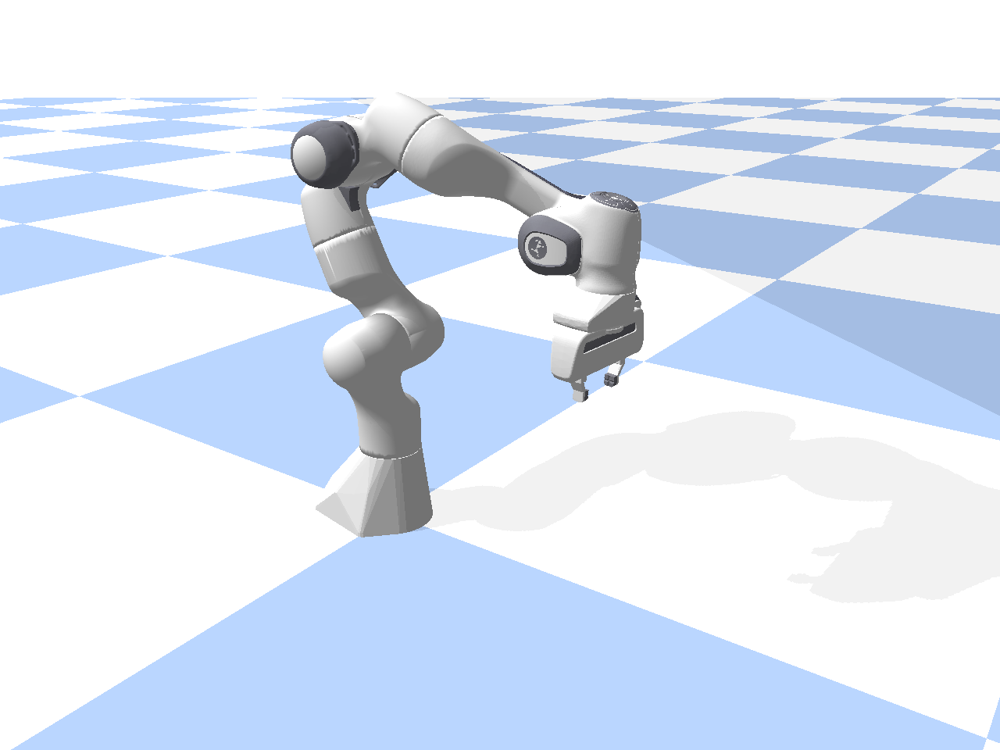
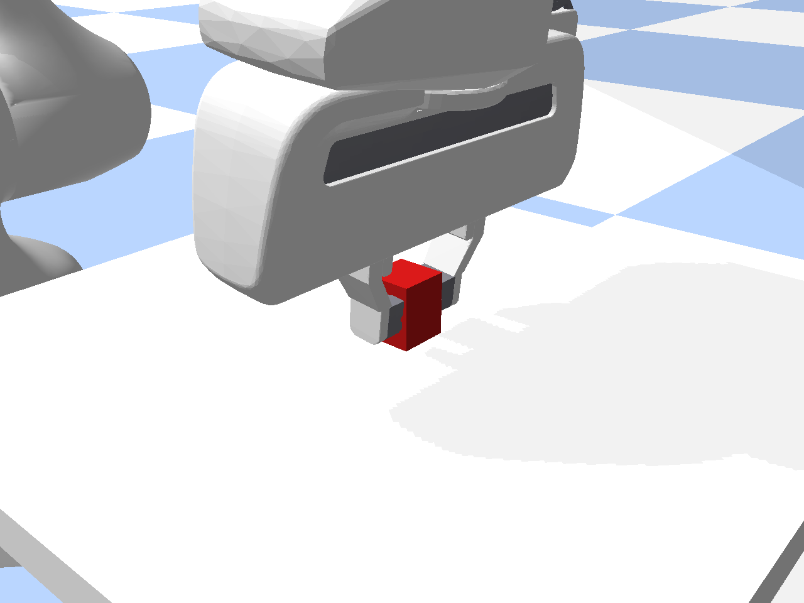
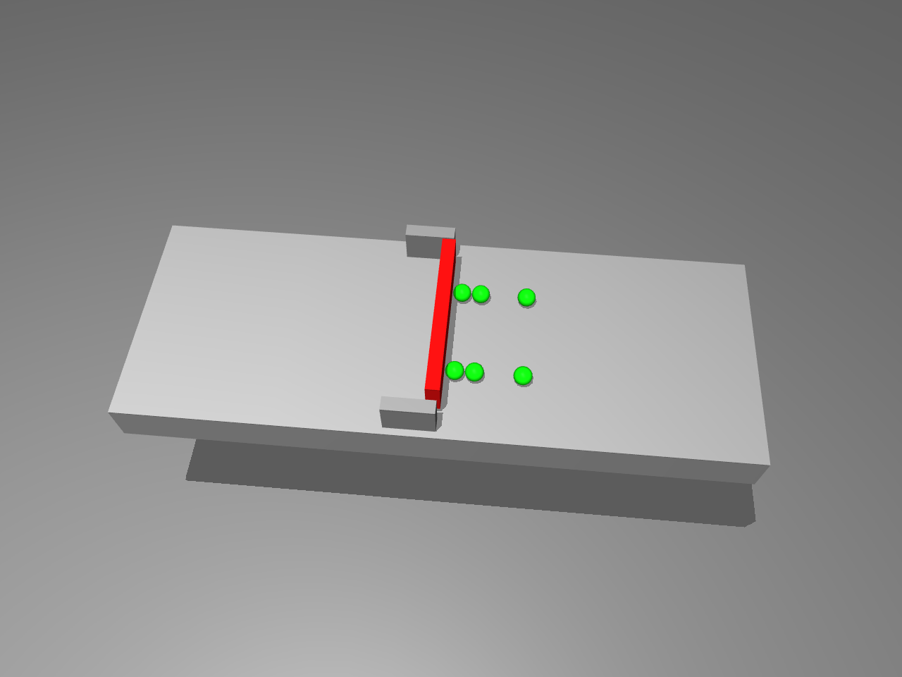
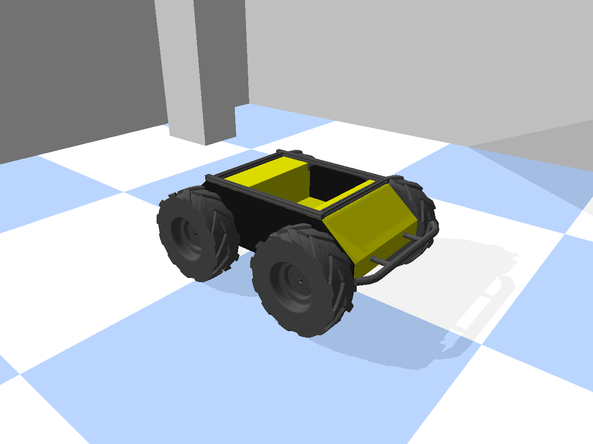
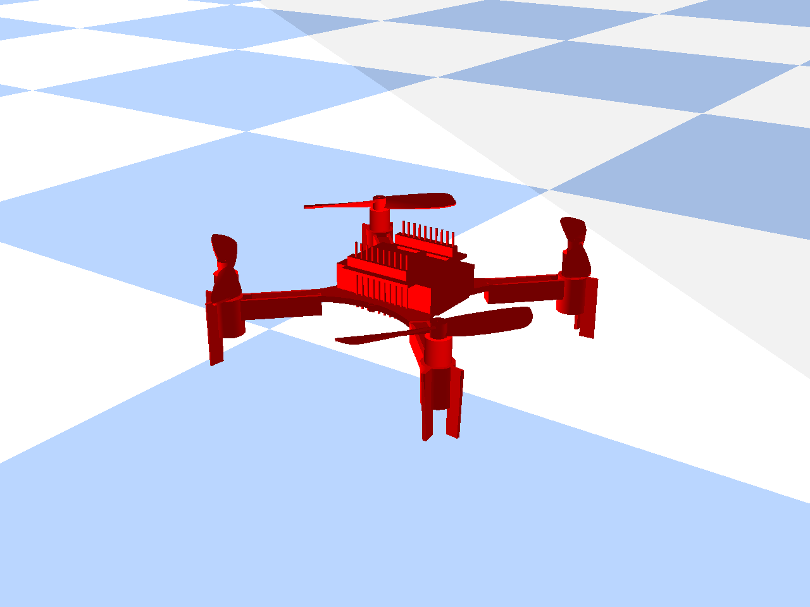
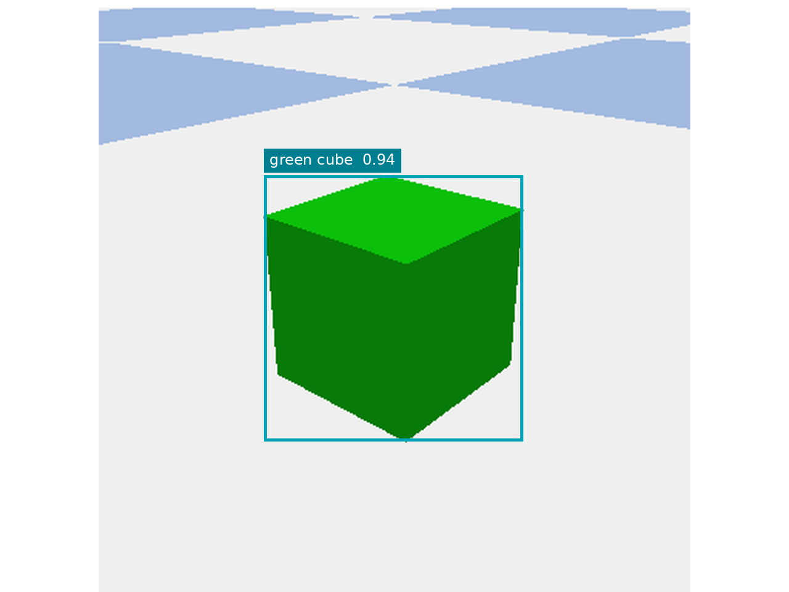

[English](atomic-skills.md) · [简体中文](atomic-skills.zh-CN.md)

# Atomic skills

The 64 engineering skills are organized into nine domains. The examples illustrate independently callable capabilities. Each call is selected for the concrete robot and environment.

<table>
<tr><td width="25%"> <strong>M05 Arm joint motion</strong></td><td width="25%"> <strong>G03 Force-controlled grasp</strong></td><td width="25%"> <strong>G04 Dexterous hand joints</strong></td><td width="25%"> <strong>A02 Hinged object motion</strong></td></tr>
<tr><td width="25%"> <strong>T04 Single wiping stroke</strong></td><td width="25%"> <strong>M08 Straight base motion</strong></td><td width="25%"> <strong>F01 Controlled vertical takeoff</strong></td><td width="25%"> <strong>P01 Object detection</strong></td></tr>
</table>

## Shared call contract

A skill defines inputs, preconditions, required capabilities, an execution budget, stopping criteria and failure feedback. The planner selects the skill and parameters, the backend generates actions, the environment executes them, and the verifier checks the goal state.

| Prefix | Domain | Count |
| --- | --- | --- | --- |
| P | Perception | 12 |
| M | Motion | 11 |
| G | Grasping and grippers | 8 |
| I | Object interaction | 9 |
| A | Articulated objects | 6 |
| T | Tool use | 2 |
| N | Navigation | 6 |
| F | Flight | 8 |
| U | Gimbals and payloads | 2 |

The engineering list uses G11 for gripper zero calibration and G12 for response self-test. The packaged v2.2 execution catalog retains G07/G08 suction interfaces. These are different operations, so executable IDs must come from the selected catalog version.

## Engineering skill list

| ID | Engineering name | 中文名称 |
| --- | --- | --- |
| P01 | Detect objects | 目标检测 |
| P02 | Segment instances | 物体分割 |
| P03 | Estimate object pose | 物体位姿识别 |
| P04 | Estimate depth | 场景深度感知 |
| P05 | Track object finite | 阶段性目标跟踪 |
| P06 | Classify object attributes | 物体属性识别 |
| P07 | Estimate affordances | 可操作性分析 |
| P08 | Estimate articulation | 物体关节识别 |
| P09 | Estimate object state | 物体状态识别 |
| P10 | Read force torque | 力觉数据读取 |
| P11 | Detect contact | 接触检测 |
| P12 | Read robot state | 机器人状态读取 |
| M01 | Move ee linear | 末端定距直线移动 |
| M02 | Move ee waypoints | 末端多点路径移动 |
| M03 | Rotate ee in place | 末端旋转 |
| M04 | Move ee pose | 末端移动 |
| M05 | Move arm joints | 机械臂关节调节 |
| M06 | Hold ee pose | 末端定时静止 |
| M08 | Move base linear | 底盘直线移动 |
| M09 | Rotate base in place | 底盘原地旋转 |
| M10 | Stop robot motion | 机器人减速停止 |
| M11 | Move bimanual poses | 双臂同步移动 |
| M12 | Servo ee to target finite | 视觉闭环微调 |
| G01 | Set parallel gripper width | 夹爪开合度调节 |
| G03 | Grasp parallel force | 夹爪力控抓取 |
| G04 | Set hand joint positions | 灵巧手关节控制 |
| G05 | Close hand grasp | 灵巧手模式化抓握 |
| G09 | Regulate grasp force | 抓取力保持与调节 |
| G10 | Hold gripper state | 末端工具定时保持 |
| G11 | Gripper zero calibration | 夹爪零点标定 |
| G12 | Gripper step-response self-test | 夹爪响应性能自检 |
| I01 | Push object linear | 物体直线推动 |
| I02 | Pull object linear | 物体直线拉动 |
| I04 | Rotate object planar | 物体平面旋拧 |
| I06 | Translate held object vertical | 抓取物垂直升降 |
| I08 | Place held object | 抓取物放置落位 |
| I09 | Align held object | 抓取物姿态对准 |
| I10 | Insert held object | 抓取物直线插装 |
| I11 | Extract held object | 抓取物直线拔出 |
| I12 | Flip held object | 抓取物空间翻转 |
| A01 | Translate prismatic joint | 滑动机构推拉 |
| A02 | Rotate revolute joint | 铰链机构开合 |
| A03 | Turn rotary control | 旋钮与阀门旋转 |
| A04 | Press button | 按钮按压操作 |
| A05 | Set discrete switch | 多挡位开关调节 |
| A07 | Set latch state | 机械锁扣开合 |
| T04 | Wipe tool stroke | 工具单次擦拭 |
| T08 | Dispense dosed | 工具定量加注 |
| N01 | Estimate self pose finite | 机器人局部定位 |
| N02 | Build local occupancy snapshot | 局部障碍物建图 |
| N03 | Infer navigation region | 地面与低空可通行区检测 |
| N04 | Observe landing patch | 备选降落区地形评估 |
| N05 | Follow ground path segment | 局部路径跟踪行驶 |
| N06 | Align base to dock | 底盘对接对准 |
| F01 | Takeoff vertical | 受控垂直起飞 |
| F02 | Land vertical | 定点精准降落 |
| F03 | Hover finite | 定点定时悬停 |
| F04 | Fly to local waypoint | 单航点直线飞行 |
| F05 | Follow air trajectory segment | 空中局部轨迹跟踪 |
| F06 | Rotate air yaw in place | 悬停机头转向 |
| F07 | Follow terrain segment | 仿地定高飞行 |
| F08 | Brake aircraft to hold | 空中减速悬停 |
| U01 | Set gimbal orientation | 云台角度调节 |
| U02 | Capture geotagged frame | 带位姿图像采集 |

[Versioned execution catalog](../catalogs/v2.2/README.md) · [Demonstration console](https://liutong-luban-project.netlify.app/offline/)
