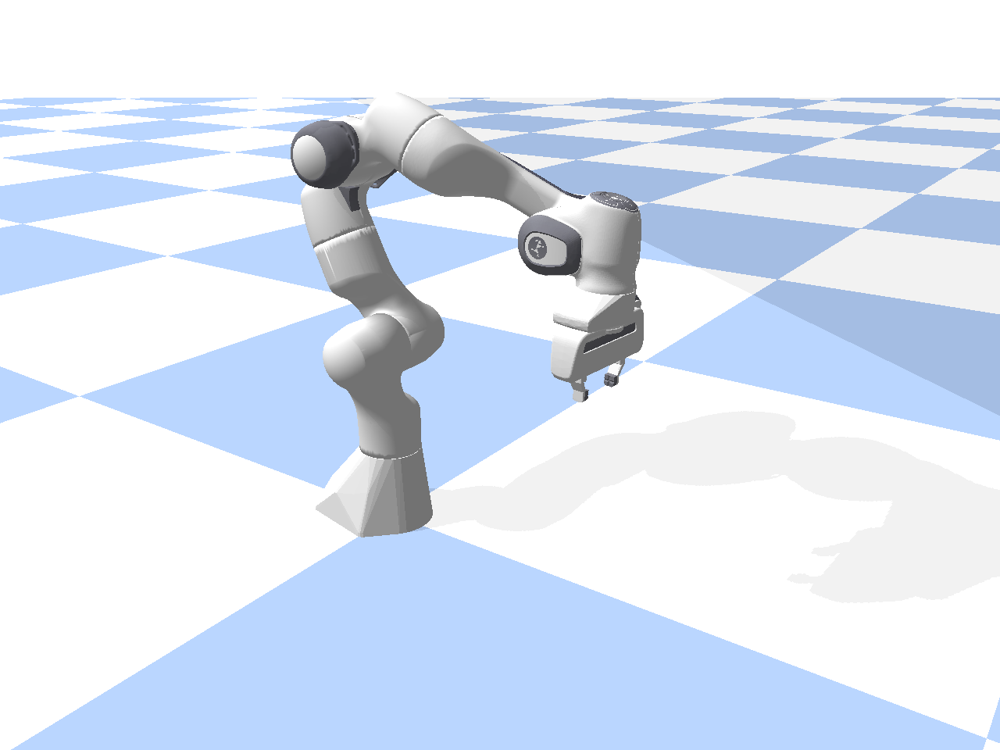
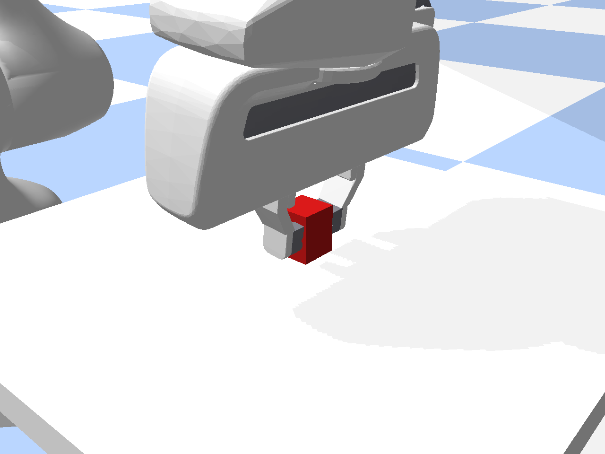
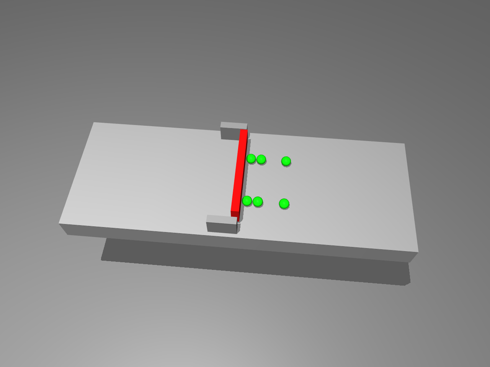
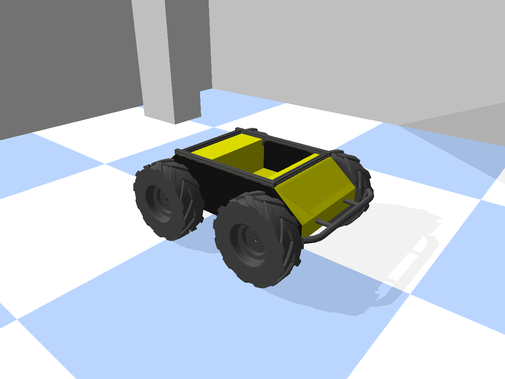
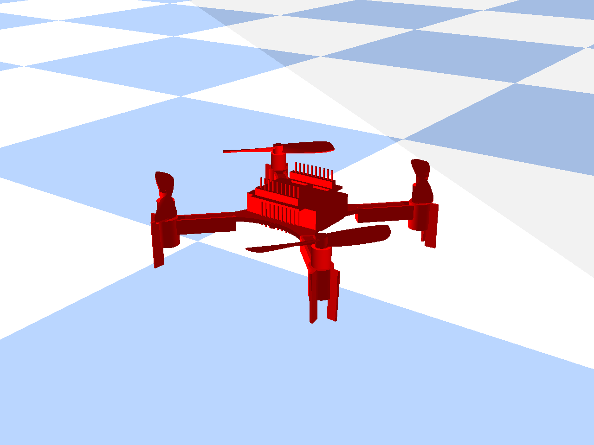
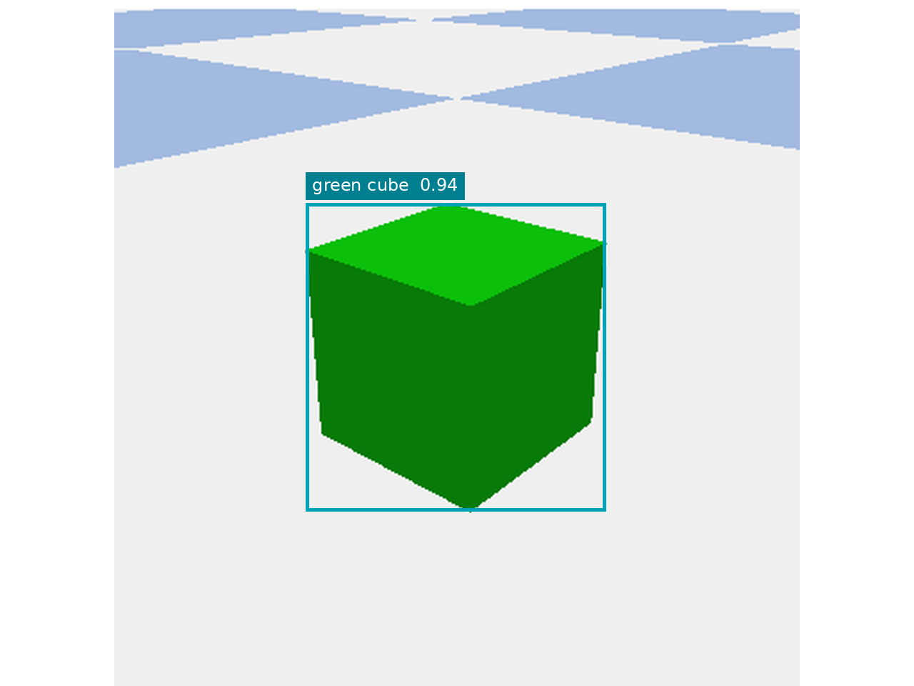

[English](atomic-skills.md) · [简体中文](atomic-skills.zh-CN.md)

# 原子技能

64项工程技能按9个功能域组织，名称采用工程常用清单。下图展示独立调用的典型能力，调用时仍需结合具体机器人与环境的能力约束。

<table>
<tr><td width="25%"> <strong>M05 机械臂关节调节</strong></td><td width="25%"> <strong>G03 夹爪力控抓取</strong></td><td width="25%"> <strong>G04 灵巧手关节控制</strong></td><td width="25%"> <strong>A02 铰链机构开合</strong></td></tr>
<tr><td width="25%"> <strong>T04 工具单次擦拭</strong></td><td width="25%"> <strong>M08 底盘直线移动</strong></td><td width="25%"> <strong>F01 受控垂直起飞</strong></td><td width="25%"> <strong>P01 目标检测</strong></td></tr>
</table>

## 统一调用契约

每个技能明确输入参数、前置条件、所需本体能力、执行预算、结束条件和失败反馈。Planner 提交技能与参数，后端生成动作，环境执行并返回反馈，Verifier 核对目标状态。

| 类别 | 功能域 | 数量 |
| --- | --- | --- |
| P | 感知 | 12 |
| M | 运动控制 | 11 |
| G | 抓取与夹爪 | 8 |
| I | 物体操作与交互 | 9 |
| A | 机构与开关操作 | 6 |
| T | 工具使用 | 2 |
| N | 地面导航与定位 | 6 |
| F | 无人机飞行控制 | 8 |
| U | 云台与载荷设备 | 2 |

工程清单中的 G11、G12 分别为夹爪零点标定和响应自检。当前随包分发的 v2.2 执行目录保留 G07、G08 吸盘接口，二者语义不同，运行时请按所选版本的技能合同选用编号。

## 工程技能清单

| 编号 | 工程名称 |
| --- | --- |
| P01 | 目标检测 |
| P02 | 物体分割 |
| P03 | 物体位姿识别 |
| P04 | 场景深度感知 |
| P05 | 阶段性目标跟踪 |
| P06 | 物体属性识别 |
| P07 | 可操作性分析 |
| P08 | 物体关节识别 |
| P09 | 物体状态识别 |
| P10 | 力觉数据读取 |
| P11 | 接触检测 |
| P12 | 机器人状态读取 |
| M01 | 末端定距直线移动 |
| M02 | 末端多点路径移动 |
| M03 | 末端旋转 |
| M04 | 末端移动 |
| M05 | 机械臂关节调节 |
| M06 | 末端定时静止 |
| M08 | 底盘直线移动 |
| M09 | 底盘原地旋转 |
| M10 | 机器人减速停止 |
| M11 | 双臂同步移动 |
| M12 | 视觉闭环微调 |
| G01 | 夹爪开合度调节 |
| G03 | 夹爪力控抓取 |
| G04 | 灵巧手关节控制 |
| G05 | 灵巧手模式化抓握 |
| G09 | 抓取力保持与调节 |
| G10 | 末端工具定时保持 |
| G11 | 夹爪零点标定 |
| G12 | 夹爪响应性能自检 |
| I01 | 物体直线推动 |
| I02 | 物体直线拉动 |
| I04 | 物体平面旋拧 |
| I06 | 抓取物垂直升降 |
| I08 | 抓取物放置落位 |
| I09 | 抓取物姿态对准 |
| I10 | 抓取物直线插装 |
| I11 | 抓取物直线拔出 |
| I12 | 抓取物空间翻转 |
| A01 | 滑动机构推拉 |
| A02 | 铰链机构开合 |
| A03 | 旋钮与阀门旋转 |
| A04 | 按钮按压操作 |
| A05 | 多挡位开关调节 |
| A07 | 机械锁扣开合 |
| T04 | 工具单次擦拭 |
| T08 | 工具定量加注 |
| N01 | 机器人局部定位 |
| N02 | 局部障碍物建图 |
| N03 | 地面与低空可通行区检测 |
| N04 | 备选降落区地形评估 |
| N05 | 局部路径跟踪行驶 |
| N06 | 底盘对接对准 |
| F01 | 受控垂直起飞 |
| F02 | 定点精准降落 |
| F03 | 定点定时悬停 |
| F04 | 单航点直线飞行 |
| F05 | 空中局部轨迹跟踪 |
| F06 | 悬停机头转向 |
| F07 | 仿地定高飞行 |
| F08 | 空中减速悬停 |
| U01 | 云台角度调节 |
| U02 | 带位姿图像采集 |

[版本化执行目录](../catalogs/v2.2/README.md) · [演示控制台](https://liutong-luban-project.netlify.app/offline/)
