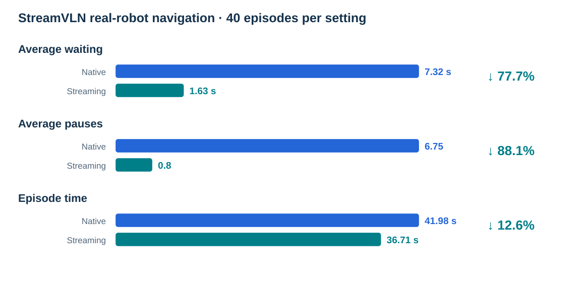
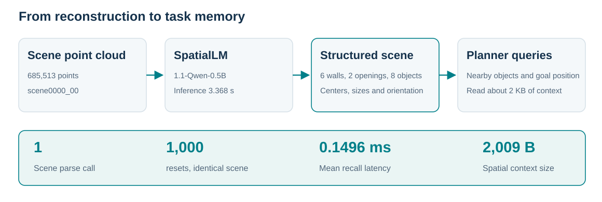

[English](reported-results.md) · [简体中文](reported-results.zh-CN.md)

# Evaluation results and settings

The tables summarize the technical report. Public methods retain their training and test settings. Sample counts, execution budgets and metric definitions follow below.

### RoboCasa365

| Method | Atomic seen (%) | Composed seen (%) | Composed unseen (%) |
| --- | --- | --- | --- |
| DP | 15.7 | 0.2 | 1.3 |
| π0 | 34.6 | 6.1 | 1.1 |
| π0.5 | 39.6 | 7.1 | 1.2 |
| GR00T-N1.6 | 51.1 | 9.4 | 1.7 |
| XR-1 | 80.2 | 57.1 | 32.1 |
| Luban / XR-1 (w/o evolution) | 82.1 | 65.0 | — |
| Luban / XR-1 | 85.5 | 68.6 | — |

### RoboTwin 2.0

| Method | Training | Clean (%) | Random (%) |
| --- | --- | --- | --- |
| π0.5 | Multi-task | 70.70 | 46.00 |
| Luban / Qwen + π0.5 | Multi-task | 61.58 | — |
| DP3 | Single-task | 55.24 | 4.96 |
| π0 | Single-task | 46.42 | 16.34 |
| RDT-1B | Single-task | 34.50 | 13.72 |
| ACT | Single-task | 29.74 | 1.74 |
| DP | Single-task | 28.04 | 0.64 |

### LIBERO

| Method | Spatial (%) | Object (%) | Goal (%) | LIBERO-10 (%) | Mean (%) |
| --- | --- | --- | --- | --- | --- |
| DP | 78.3 | 92.5 | 68.3 | 50.5 | 72.4 |
| OpenVLA | 84.7 | 88.4 | 79.2 | 53.7 | 76.5 |
| π0 | 96.8 | 98.8 | 95.8 | 85.2 | 94.2 |
| OpenVLA-OFT (without Agent) | 97.6 | 97.4 | 98.4 | 93.4 | 96.7 |
| Luban / OpenVLA-OFT | 99.4 | 99.2 | 99.4 | 97.6 | 98.9 |

## RoboCasa365 · XR-1

| Setting | Composite seen success | Atomic seen success |
| --- | ---: | ---: |
| XR-1 baseline | 57.1% | 80.2% |
| Framework without self-evolution | 65.0% | 82.1% |
| Framework with self-evolution | 68.6% | 85.5% |

Source: presentation `results.html`, `js/i18n.js` and README report notes;
atomic-seen baseline corrected in that source on 2026-10-06. Self-evolution changes
reported composite-seen success by +3.6 percentage points and atomic-seen success
by +3.4 percentage points relative to the no-evolution setting.

The supplied summary does not give the task/episode counts, seeds or statistical
tests for these three RoboCasa settings. Those details are not inferred from other
historical campaigns. No unseen result is added.

## LIBERO · OpenVLA-OFT

The report compares **Without Agent** and **Agent**, using four suites, 40 tasks,
50 original episode IDs per task, seed 7 and suite-specific OpenVLA-OFT weights.
The original comparison set contains 2,000 episode IDs.

| Suite | Without Agent | Agent |
| --- | ---: | ---: |
| libero_goal | 98.4% | 99.4% |
| libero_spatial | 97.6% | 99.4% |
| libero_object | 97.4% | 99.2% |
| libero_10 | 93.4% | 97.6% |
| **Overall** | **96.7%** | **98.9%** |

### Metric definition and execution budget

For each original episode ID, assign 1 if at least one execution record associated
with that ID has a successful outcome, otherwise 0. Divide the sum by the number
of original episode IDs. Each ID contributes at most once to the numerator.

| Suite | Original episode IDs | Without Agent: completed IDs | Agent: completed IDs |
| --- | ---: | ---: | ---: |
| libero_goal | 500 | 492 | 497 |
| libero_spatial | 500 | 488 | 497 |
| libero_object | 500 | 487 | 496 |
| libero_10 | 500 | 467 | 488 |
| **Overall** | **2,000** | **1,934** | **1,978** |

Without Agent: 1,934 / 2,000 = 96.7%, based on 2,000 executions.
Agent: 1,978 / 2,000 = 98.9%, based on 2,066 executions in the supplied report.
The two columns therefore use different execution budgets. These values do not
establish an equal-budget, single-execution comparison or a new independent run
of this package.

Source: the presentation's `results.html` and its 2026-10-04 report record,
`assets/evidence/libero-oft-replay-20261004.json`. The report values and their
underlying counts are retained; no new experiment is inferred.

Project source: [Project presentation](https://github.com/yuliu-ai/OmniRoboAgent-Page).
This package’s runnable GPU entry is the [episode guide](episodes.md).

## RoboTwin 2.0 and RoboSynChallenge

The 2026-10-13 website includes two supplied reports. RoboTwin 2.0 uses demo_clean, 50 tasks and 100 episodes per task: 3,079 successes out of 5,000 episodes (61.58%). The configuration uses a Qwen3.5-9B LoRA planner and shared multi-task π0.5 policy, from branch omniagent/robotwin-integration at commit 52d8a314e3679ba1cc6d2b0ecaf3caf11bfd313e.

RoboSynChallenge uses the random setting, seeds 0–99 per task and 10 tasks: 412 successes out of 1,000 episodes (41.2%). It uses Qwen3.5-9B visual planning/verification and public task-specific ACT checkpoints. See the [2026-10-12 branch report](https://github.com/choucaicai/OmniRoboAgent/blob/c9901442c396741fc3d30b73d7e6f058af09ca08/docs/robosynchallenge-results.md). This benchmark is separate from the earlier fixed-titration Isaac Sim demonstration.

Complete task values remain in the website's assets/evidence/robotwin-results-20261009.json and robosynchallenge-results-20261012.json. These existing report results were not rerun in this repository. See the [spatial memory report](spatial-memory-report.md) for scene records and interface timing.

## Additional technical-report results

The Uniubi quadruped has 40 episodes per setting. Streaming execution reduces mean waiting time from 7.32 s to 1.63 s, pauses from 6.75 to 0.80, and episode time from 41.98 s to 36.71 s. End@2m is 15/40 versus 16/40, with no statistically significant endpoint-accuracy improvement reported.

After 1,000 resets, the global-scene content remains unchanged and the total backend-call count remains 1. The spatial context supplied to Planner is 2,009 B. Recall timing measures access to parsed results, separately from model inference. See the [technical-report evidence](assets/evidence/technical-report-results-20261021.json).
